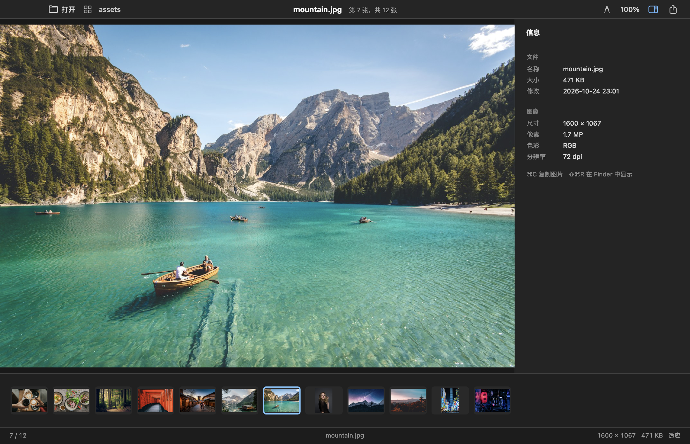

<p align="center">
  
</p>

<h1 align="center">Mira</h1>

<p align="center">
  <strong>打开文件夹，按方向键，把图一口气看完。</strong>
</p>

<p align="center">
  <a href="https://github.com/Mrhs121/Mira/actions/workflows/build.yml"></a>
  <a href="LICENSE"></a>
  
</p>



Mira 是一个 macOS 原生图片浏览器，做的是件很小的事：打开一个文件夹，按方向键，把里面的图一口气看完。

没有导入，没有图库，没有云同步。图片就在磁盘上，Mira 只负责把它们顺顺当当地显示出来。大图不会等整张解码完才出现——先给个骨架，后台补细节，需要放大时再取 6144px 纹理，顺便把前后几张也准备好。滚轮或触控板捏合以指针为中心缩放，按住图片可以平移，手感接近看 PDF。

标注功能是照着 macOS「预览」做的：顶部工具栏，矩形、椭圆、直线、文字、裁切、旋转，颜色和 6 档线宽改完立刻生效。文字直接点在图上输入，不用先弹对话框。做好后可以 `⌘C` 复制合成图，或者另存一张 PNG 副本，原图不会被动。

目前只支持 Apple Silicon 和 macOS 14 及以上。

## 功能

### 看图

- 打开图片会自动串起同目录的图片，`←` / `→` / `Space` 连续翻页。
- `G` 在网格和大图之间切换；`F` 全屏；`S` 幻灯片。
- 滚轮上下缩放，触控板捏合也可以；缩放以鼠标指针为锚点。
- 图片内单击拖拽平移；双击在「适应窗口」和「100% 实际像素」之间切换。
- `I` 打开右侧信息面板，查看 EXIF、色彩空间和尺寸。

### 标注

按 `⌘E` 打开编辑面板。工具都在顶部：矩形、椭圆、直线、文字、裁切、旋转。画完可以继续选中拖动、改颜色、改线宽，也可以按 `Delete` 删掉。

- 文字：选文字工具后点空白处直接输入；点已有形状只会选中，不会误开文字框。
- 线宽：6 档下拉选择，菜单里用按真实比例画出的横线表示粗细。
- 颜色：内置色板和 HEX 输入，不调用系统取色器。
- 裁切：拖出裁切框后应用；原图仍不动。
- 输出：`⌘C` 复制当前合成图，或保存为 PNG 副本。

### 整理

重命名、移到废纸篓、`⌘Z` 撤销删除、在 Finder 中显示、系统分享，这些都在右键菜单里。

## 性能

测试环境是 Apple M1 Max / 32GB / macOS 27.2，样本为 80MB 左右的高像素图片：

| 样本 | 分辨率 | 阶段 | 耗时 |
| :--- | :--- | :--- | :--- |
| 80MB PNG | 7000 × 5000 | 适应窗口解码 | 471–598 ms |
| 80MB PNG | 7000 × 5000 | 6144px 细节 | 571 ms |
| 80MB JPEG | 10000 × 7500 | 适应窗口解码 | 741 ms |
| 相邻大图翻页 | 连续翻页 | 预取命中 | 0 ms（仅缓存命中时） |

首帧会先出骨架，所以上面是「完整画面可用」的时间，不是白屏时间。翻页的 0 ms 也只发生在预取已经完成的情况下。

## 安装

### 直接下载

从 [Releases](https://github.com/Mrhs121/Mira/releases/latest) 下载 `Mira-macos-arm64.zip` 或 `.dmg`，解压后把 `Mira.app` 拖进「应用程序」。

这个版本是 ad-hoc 签名，没有做 Apple 公证。如果系统提示“无法验证开发者”，先右键 `Mira.app` → 打开；如果还是被拦，可以执行：

```bash
xattr -dr com.apple.quarantine /Applications/Mira.app
```

只对你信任的来源这样做。

### 从源码构建

需要 macOS 14+、Apple Silicon，以及带 Swift 5.9 的 Xcode Command Line Tools。

```bash
git clone https://github.com/Mrhs121/Mira.git
cd Mira/app
./build.sh
open build/Mira.app
```

装进 `/Applications`：

```bash
rm -rf /Applications/Mira.app
ditto build/Mira.app /Applications/Mira.app
```

也可以从命令行直接打开某个目录或图片：

```bash
./build/Mira.app/Contents/MacOS/Mira ~/Pictures
```

## 快捷键

| 按键 / 操作 | 功能 |
| :--- | :--- |
| `⌘O` | 打开图片或文件夹 |
| `←` / `→` / `Space` | 上一张 / 下一张 |
| 滚轮上下 | 以指针为中心放大 / 缩小 |
| 画布内单击拖拽 | 平移图片 |
| 双击图片 / `Z` | 适应窗口 / 100% 实际像素 |
| `1` | 100% 实际像素 |
| `G` | 网格浏览 / 大图查看 |
| `I` | 显示 / 隐藏信息面板 |
| `⌘E` | 打开标注与裁切编辑器 |
| `⌘C` | 复制当前图片（编辑态下复制合成图） |
| `Delete` / `⌘Z` | 移到废纸篓 / 撤销删除 |
| `F` / `S` | 全屏 / 幻灯片 |

编辑态下 `Delete` 删除选中标注；查看态下 `Delete` 才会把文件移到废纸篓。

## 目录

```text
Mira/
├── README.md
├── LICENSE
├── app/
│   ├── README.md              # 更细的开发与使用说明
│   ├── Package.swift
│   ├── build.sh
│   ├── Sources/
│   │   ├── MiraCore/          # 解码、目录扫描、元数据、预取缓存
│   │   ├── MiraApp/           # AppKit 界面、画布、网格、标注编辑器
│   │   └── MiraBench/         # 大图解码基准
│   └── Resources/             # Info.plist、图标
├── prototype/                 # 早期交互原型和示例图
├── PRODUCT_DESIGN.md
└── PERF_80MB.md
```

## 已知限制

- 只支持 Apple Silicon（arm64），不支持 Intel Mac。
- 标注文字目前是单行；还没有撤销 / 重做、图层和蒙版。
- 编辑器会把工作图的长边压到 8192px 以内，超大图保存出来的也是工作图尺寸。
- 裁切需要先应用，再保存或复制。
- 下载版是 ad-hoc 签名，未公证；首次打开可能需要按上面的步骤放行。

## 开发

```bash
cd app
./build.sh
```

涉及 UI 的改动，建议顺手跑一下构建并附一张前后对比图。更细的模块说明在 [app/README.md](app/README.md)。

欢迎提 issue 和 PR；如果是比较大的改动，先开 issue 聊一下方向，避免白做。

## 发布

`main` 分支的每次 push 只跑构建并上传 Actions artifact，不会改动 Release。

要发正式版本，先改 `app/Resources/Info.plist` 里的版本号，再打 tag：

```bash
git tag v0.1.1
git push origin v0.1.1
```

只有 `v*` tag 会创建对应的 GitHub Release。

## License

[MIT](LICENSE)
